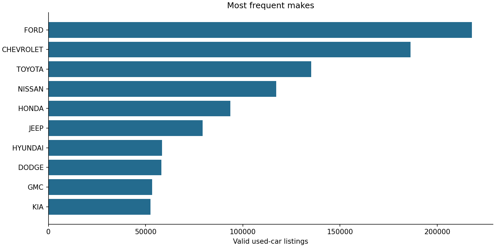
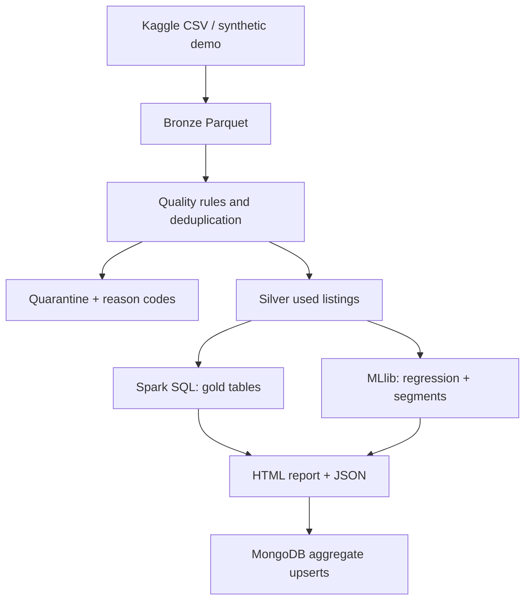

# Used Cars Spark Pipeline

A local data engineering portfolio project: **PySpark, SQL, Parquet, data quality, MLlib and MongoDB**, packaged with Docker and automated checks. It turns a 9.98 GB historical vehicle-listing CSV into auditable analytical tables and an asking-price report.

The project builds on a university Big Data/NoSQL notebook. The pipeline code, quality rules, validation strategy and reproducible runs are documented here. Azure and Databricks deployment are future extensions; this version runs Spark locally.

## Measured run on the full source CSV

The committed [Kaggle run artifacts](reports/kaggle-v1) come from processing the actual **9.98 GB** version-1 file, not the synthetic demonstration. The input hash, configuration and environment are in [the manifest](reports/kaggle-v1/manifest.json).

| Measurement | Result |
| --- | ---: |
| Parsed source records | 3,000,040 |
| Invalid core measurements | 144,387 |
| Valid records outside the study scope | 1,347,315 |
| Duplicate listings removed | 24 |
| Silver used-car listings | 1,508,314 |
| ML input: approximately 5% of vehicle groups | 74,952 |
| Train / validation / test rows | 52,597 / 11,172 / 11,183 |
| Selected candidate | GBT, depth 5, 20 iterations |
| Test MAE / RMSE | $4,055.92 / $7,710.43 |
| Test R² | 0.7598 |
| Train-mean baseline test RMSE | $15,734.42 |

ETL and Spark SQL used the entire input; **ML used only the recorded group sample**. The local `local[2]` run took 167.4 seconds for ingestion, including hashing and quality outputs, and 37.1 seconds for SQL, ML and report analysis. These are one-machine observations, not performance guarantees. See [validation scores](reports/kaggle-v1/regression.json), [quality details](reports/kaggle-v1/quality.json) and [the report](reports/kaggle-v1/report/index.html).

For the defined `count + sum(price)` projection, three alternating scans gave median times of **24.891 s for CSV** and **0.508 s for bronze Parquet**. This is a column-pruned workload with an uncontrolled OS cache, not an end-to-end pipeline speedup. The [raw timings and execution context](reports/kaggle-v1/benchmark.json) document the comparison.



## What it demonstrates

- Explicit 66-column CSV schema, correct quoted/multiline parsing, SHA-256 input identity.
- Bronze Parquet, typed silver listings, quarantine records and exact row reconciliation.
- Deterministic listing deduplication and a documented used-car population.
- Spark SQL aggregations and an HTML report with bounded aggregate-only plotting.
- VIN-grouped train/validation/test, train-only imputation and one-hot encoding, mean baseline, ridge and GBT regression.
- K-Means candidate comparison with silhouette and readable segment summaries.
- Run-scoped MongoDB upserts, health checks, meaningful tests and GitHub Actions.



## Start with the synthetic demo

Install Docker Desktop with Docker Compose v2. On Windows, enable its WSL2 backend. From the repository directory:

```bash
docker compose build
docker compose up -d mongo
docker compose run --rm pipeline cars demo
docker compose run --rm pipeline cars run \
  --input data/demo/used_cars_data.csv --output outputs/demo \
  --run-id demo-v1 --dataset-kind synthetic --publish-mongo
```

Open `outputs/demo/report/index.html` in a browser. Everything in this run is **synthetic**, including its metrics. The default generator produces 1,200 records with intentional missing values, duplicates and invalid records. On PowerShell, write each command on one line or use PowerShell's backtick continuation instead of `\`.

Output directories must be empty for ingestion. Use a new directory and run ID for a new experiment. Repeating `cars publish --output outputs/demo` updates the same MongoDB documents; it does not append duplicates or delete other runs.

## Run the actual Kaggle data

Source: [US Used cars dataset — AnanayMital](https://www.kaggle.com/datasets/ananaymital/us-used-cars-dataset), **version 1**, collected from CarGurus inventory in **September 2020**. The source CSV is `used_cars_data.csv`, **9,980,208,148 bytes**, with 66 columns. The ZIP download is approximately 2.29 GB.

The source notice limits use to academic, research and individual experimentation, with “Data files © Original Authors”. The repository does not redistribute raw listings. Download from Kaggle yourself if the public API requires authentication; never commit account tokens.

```bash
docker compose run --rm pipeline cars download
docker compose run --rm pipeline cars run \
  --input data/raw/used_cars_data.csv --output outputs/kaggle-v1 \
  --run-id kaggle-v1 --dataset-kind kaggle --partitions 8 \
  --model-fraction 0.05 --publish-mongo
```

ETL and SQL always process the entire supplied CSV. `--model-fraction 0.05` limits **only ML** to a deterministic approximately 5% sample of vehicle groups. Use `1.0` to train on all silver listings. This does not promise better metrics. The grouped sample size and split counts are saved in the results.

Allow about **30 GB free disk space** for the archive, extracted CSV, Parquet, shuffle and models; exact requirements depend on the data and configuration. For full-data work, allocate at least 8 GB RAM to Docker; more memory and disk headroom are useful. The Compose default driver heap is 2 GB and can be changed with `SPARK_DRIVER_MEMORY`. This is local execution, not a distributed-cluster benchmark. Multiline parsing of one CSV file is initially a single input task; subsequent Parquet/shuffle work is parallel.

## Inspect and restart stages

```bash
docker compose run --rm pipeline cars ingest \
  --input data/raw/used_cars_data.csv --output outputs/etl-only \
  --run-id etl-only --dataset-kind kaggle --model-fraction 0.05
docker compose run --rm pipeline cars analyze --output outputs/etl-only
docker compose run --rm pipeline cars publish --output outputs/etl-only
docker compose run --rm pipeline cars benchmark \
  --input data/raw/used_cars_data.csv --output outputs/etl-only --repeats 3
```

`analyze` restores the run configuration from the manifest and reads silver Parquet. It refuses to overwrite existing gold/models. If analysis fails partway, retain bronze/silver/quality and remove only the failed run's generated `gold`, `models`, `report`, `regression.json`, `clustering.json` and `results.json` before retrying. Ingestion deliberately refuses any nonempty output directory.

The benchmark alternates an equivalent `count + sum(price)` projection over CSV and bronze Parquet. It records individual timings, medians, software and caveats. Spark caches are cleared; the OS filesystem cache is not controlled. Do not interpret this as a universal format speedup.

## Population and quality rules

The target is an **advertised asking price in USD**, not the price of a completed sale. Mileage uses **miles**. We analyze listings explicitly marked `is_new=False`, with price above $500 and model year 1991–2021, reflecting the historical snapshot.

| Case | Treatment |
| --- | --- |
| Malformed CSV, missing/nonfinite price or mileage, negative mileage, invalid year, missing make, unknown new/used flag | Invalid; quarantine with reason codes |
| New vehicle, price at/below $500, model year outside 1991–2021 | Out of study scope; quarantine |
| Repeated listing key | Keep latest `listed_date`, then stable record hash; quarantine other rows |
| Missing/invalid horsepower | Retain; median imputation learned from train only |
| Price above $150k, mileage above 300k, horsepower above 1000 | Flag for inspection; retain |
| Missing/unusable VIN | Keep; group by listing ID, then selected-field record hash as fallback |

`input_rows = invalid_rows + out_of_scope_rows + duplicate_rows + silver_rows`. Invalid has priority over out-of-scope when both apply. Primary reasons are exclusive; all-reason counts can overlap. Spark's permissive CSV parser does not flag every short/long row as corrupt; schema validation and typed domain rules complement its `_corrupt_record` indicator. Bronze retains all source columns; quarantine keeps the selected raw values and reason codes.

Listing keys prefer listing ID, then usable VIN, then a hash of selected raw fields. VIN grouping keeps separate listings for the same known vehicle in one ML split. Without a usable VIN, cross-listing identity cannot be guaranteed. A VIN-shaped value is not checked against an external vehicle registry.

## Model evaluation

The deterministic hash of `vehicle_key` assigns groups to approximately **70% train, 15% validation, 15% test**. Preprocessing is fitted within each training pipeline. Makes and other nominal categories use one-hot encoding; unseen categories are supported. No description, dealer ID, image URL or listing ID is a predictive feature.

The train-mean baseline, ridge regression and two small GBT candidates are evaluated on validation. Validation RMSE chooses the trained candidate. The selected candidate and baseline are reported on test in MAE/RMSE (USD) and R². No target R² is promised. Extreme listings can strongly affect squared-error metrics. Temporal validation is not claimed for this single historical inventory snapshot.

K-Means compares k=3,4,5 with standardized price, mileage and model year. In-sample squared-Euclidean silhouette supports exploratory selection; it does not establish stable or business-validated segments. Cluster IDs have no ordinal meaning.

## Files and outputs

```text
src/used_cars/       ETL, Spark SQL, ML, MongoDB, CLI and reports
notebooks/          Presentation notebooks calling the package
tests/              Parsing, quality, grouping, ML and MongoDB checks
docs/               Decisions, legacy notebook audit, Databricks roadmap
reports/            Small, explicitly labelled reproducible example reports
outputs/<run>/      Ignored generated layers, artifacts and reports
```

Each run saves `manifest.json`, `quality.json`, bronze/silver/quarantine Parquet, gold SQL tables, `results.json`, an HTML report and, when enabled, model artifacts plus explicit split assignments. Raw CSV, archive, credentials and generated bulk data are ignored by Git.

## Local development and notebooks

Python 3.11 is recommended. Install **Java 17** for local PySpark execution, then:

```bash
python -m venv .venv
# Linux/macOS: source .venv/bin/activate
# Windows PowerShell: .venv\Scripts\Activate.ps1
python -m pip install -r requirements-dev.txt
python -m pip install --no-deps -e .
ruff check .
ruff format --check .
pytest -q
```

**Why Java?** PySpark is the Python API; Spark's execution engine runs on the JVM. We write Python and SQL. The Docker image installs Java 17 inside the container, so Docker users do not need a separate host Java installation. Versions are fixed for the main runtime packages; transitive pins are in `requirements*.txt`. Container OS packages can receive security updates, so these builds are not claimed to be bit-for-bit identical.

```bash
docker compose --profile notebooks up -d notebooks
docker compose logs notebooks
```

Open the token-protected Jupyter URL on `localhost:8899` printed in the logs. MongoDB is available only on the Compose internal network; it has no host port by default. Jupyter and Spark UI ports bind to localhost. For MongoDB tests use the Compose `test` profile; credentials for other deployments belong in environment variables, never source files.

## Further work

See [engineering decisions](docs/decisions.md), [legacy notebook audit](docs/legacy-audit.md) and [Databricks/Azure extension](docs/databricks-roadmap.md). The existing university results must not be presented as results from this rewritten pipeline.
